# Predictor Saber 11 · Antioquia

Aplicación web que predice el **puntaje global de la prueba Saber 11** de un estudiante de Antioquia a partir de sus datos socioeconómicos y del colegio, usando un modelo de Machine Learning entrenado con los resultados oficiales del periodo **2022-2**.

**Aplicación desplegada:** https://saber11-predictor.onrender.com

> La aplicación usa el plan gratuito de Render: si no recibe visitas durante 15 minutos se suspende, y la primera visita posterior puede tardar alrededor de un minuto en responder.

Proyecto de la asignatura **Programación Avanzada** · Autora: **Daniela Londoño**

## Contenido

1. [Funcionalidades](#funcionalidades)
2. [Tecnologías](#tecnologías)
3. [Arquitectura](#arquitectura)
4. [Modelo de Machine Learning](#modelo-de-machine-learning)
5. [Base de datos](#base-de-datos)
6. [API REST](#api-rest)
7. [Cómo ejecutarlo](#cómo-ejecutarlo)
8. [Observabilidad con Datadog](#observabilidad-con-datadog)
9. [Pruebas](#pruebas)
10. [Decisiones y limitaciones](#decisiones-y-limitaciones)

## Funcionalidades

- **Predicción:** formulario con los datos del estudiante; devuelve el puntaje estimado, un rango probable (± RMSE) y una etiqueta según los cuartiles de los datos de entrenamiento.
- **Historial:** cada predicción queda guardada en PostgreSQL con sus entradas, resultado, versión del modelo y latencia (trazabilidad).
- **Datos:** ingesta (ETL) de los resultados desde el portal de datos abiertos **datos.gov.co**, normalizados en 3FN, con historial de cargas y un explorador paginado con filtros.
- **API REST:** todos los servicios están expuestos como endpoints JSON.
- **Observabilidad:** logs estructurados en JSON enviados a **Datadog**.

## Tecnologías

| Capa | Tecnología |
|---|---|
| Modelo | scikit-learn (HistGradientBoostingRegressor), pandas, joblib |
| Backend / API | Python 3.12, Flask, Gunicorn |
| Persistencia | PostgreSQL 17 (local) y Neon (nube), SQLAlchemy |
| Interfaz | Jinja2, Bootstrap 5, JavaScript |
| Contenedores | Docker, Docker Compose |
| Despliegue | Render (app) + Neon (base de datos) |
| Observabilidad | Datadog Agent |
| Pruebas | pytest (22 pruebas) |

## Arquitectura

La aplicación es un **monolito modular en capas**: un solo servicio desplegable, organizado internamente en capas con responsabilidades separadas. Cada capa solo conoce a la de abajo.

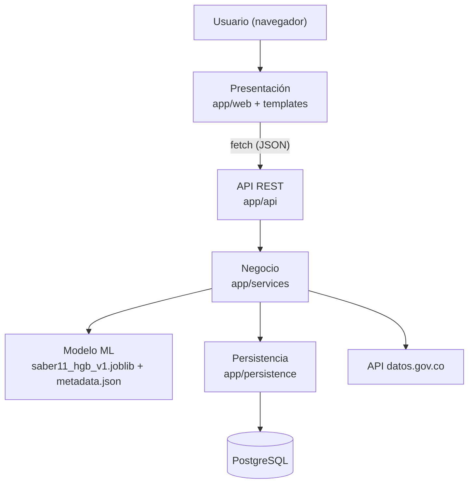

| Capa | Carpeta | Responsabilidad |
|---|---|---|
| Presentación | `app/web`, `app/templates` | Páginas HTML (Predicción, Historial, Datos) |
| API | `app/api` | Endpoints REST, validación de la petición y códigos HTTP |
| Negocio | `app/services` | Preparar entradas, predecir, ejecutar la ingesta (ETL) |
| Persistencia | `app/persistence` | Modelos ORM (SQLAlchemy) y consultas a la base de datos |

**Decisiones principales:**

- **Entrenamiento offline, inferencia online.** El modelo se entrena una vez (`training/train_model.py`) y se exporta como artefacto versionado. La aplicación solo lo carga y predice; no reentrena.
- **`metadata.json` como fuente única de verdad.** Guarda las columnas, opciones válidas, transformaciones, cuartiles y métricas del modelo. La app lee de ahí las reglas de preprocesamiento, lo que evita diferencias entre entrenamiento y producción (*training-serving skew*).
- **Application factory** (`create_app()`): la app se construye con su configuración desde variables de entorno, lo que facilita las pruebas y el despliegue en distintos entornos.

### Entornos de ejecución

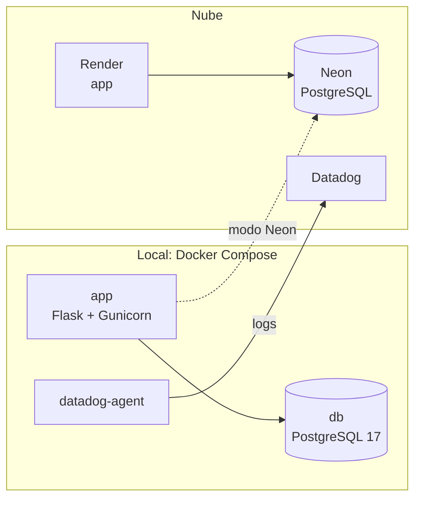

- **Local:** tres contenedores. Los datos de PostgreSQL persisten en el volumen `pgdata`, aunque se apaguen los contenedores.
- **Modo Neon:** la misma app local apunta a la base de datos en la nube. Se usa para cargar los datos de datos.gov.co en Neon.
- **Producción:** Render construye la imagen desde el `Dockerfile` del repositorio y se conecta a Neon. Ambos entornos comparten la misma base de datos en la nube.

### Estructura del proyecto

```
├── app/
│   ├── api/            # Endpoints REST
│   ├── web/            # Rutas de las páginas
│   ├── templates/      # HTML (Jinja2 + Bootstrap)
│   ├── services/       # Lógica de negocio: modelo, predicción, ingesta
│   ├── persistence/    # ORM, tablas y consultas
│   ├── config.py
│   └── logging_config.py
├── models/             # Modelo entrenado (.joblib) y metadata.json
├── training/           # Scripts de entrenamiento y análisis
├── notebooks/          # Notebook de exploración y selección del modelo
├── tests/              # Pruebas con pytest
├── Dockerfile
├── docker-compose.yml
└── docker-compose.neon.yml
```

## Modelo de Machine Learning

### Problema

Regresión: predecir `punt_global`, el puntaje global de Saber 11 (escala de 0 a 500), a partir de 21 variables del estudiante, su familia y su colegio.

### Datos

- **Fuente:** resultados oficiales de Saber 11 publicados por el ICFES en el portal de datos abiertos **datos.gov.co**.
- **Alcance:** estudiantes de **Antioquia**, periodo **2022-2**.
- **División:** 80 % entrenamiento y 20 % prueba (`random_state=42`, para que el resultado sea reproducible).

### Modelo seleccionado

**HistGradientBoostingRegressor** de scikit-learn, elegido como el mejor de los modelos comparados en el notebook de selección (`notebooks/`).

Hiperparámetros finales:

| Hiperparámetro | Valor |
|---|---|
| `learning_rate` | 0.1062 |
| `max_iter` | 367 |
| `max_depth` | 7 |
| `min_samples_leaf` | 88 |
| `l2_regularization` | 0.0011 |

El modelo se entrena y se exporta con `training/train_model.py` como un **Pipeline** de scikit-learn (`ColumnTransformer` + regresor), de modo que el preprocesamiento viaja junto con el modelo.

### Métricas

| Métrica | Valor |
|---|---|
| RMSE en el conjunto de prueba | **40.42 puntos** |
| RMSE en validación cruzada | 40.55 ± 0.17 |

El RMSE equivale a cerca del **17 %** del puntaje mediano (242). La desviación pequeña en validación cruzada indica que el error es estable entre particiones de los datos.

### Cómo se presenta el resultado

- **Puntaje estimado** del estudiante.
- **Rango probable:** puntaje ± RMSE.
- **Etiqueta** según los cuartiles de los puntajes de entrenamiento:

| Etiqueta | Rango de puntaje |
|---|---|
| Bajo | menor a 205 |
| Medio-bajo | 205 a 242 |
| Medio-alto | 242 a 283 |
| Alto | mayor a 283 |

### Artefactos

| Archivo | Contenido |
|---|---|
| `models/saber11_hgb_v1.joblib` | Pipeline entrenado (preprocesamiento + modelo) |
| `models/metadata.json` | Versión, entorno de entrenamiento, métricas, columnas, opciones válidas, transformaciones, cuartiles y ejemplos |

La aplicación valida y transforma las entradas usando las reglas guardadas en `metadata.json` (por ejemplo, el rango válido de edad o el tratamiento de la opción «No sabe»), para que los datos lleguen al modelo exactamente como los vio durante el entrenamiento.

## Base de datos

PostgreSQL con el ORM **SQLAlchemy** (Flask-SQLAlchemy). El esquema está **normalizado en tercera forma normal (3FN)**: el diseño parte de un análisis de dependencias funcionales sobre los datos de datos.gov.co (`training/revisar_dependencias.py`), que mostró, por ejemplo, que el código ICFES de la sede corresponde uno a uno con la pareja (sede, jornada). Así cada dato del colegio se guarda una sola vez y no se repite en cada estudiante.

<!-- VERIFICAR: confirmar las relaciones contra app/persistence/models.py -->

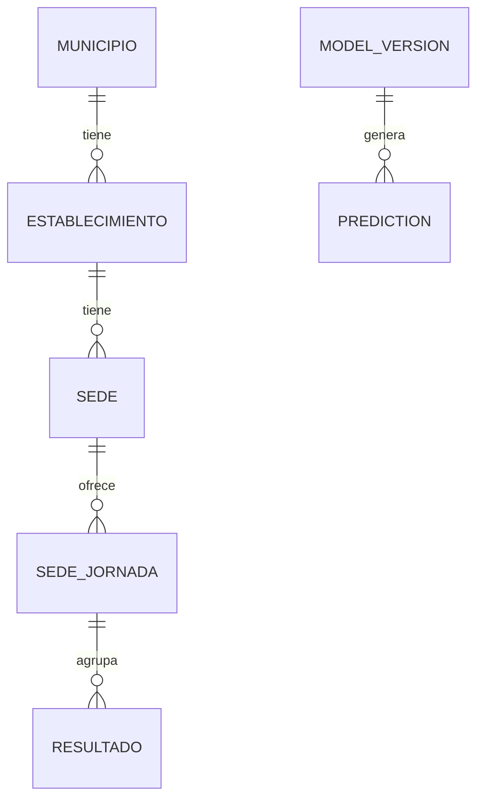

| Tabla | Contenido |
|---|---|
| `municipio` | Municipios de Antioquia |
| `establecimiento` | Colegios (naturaleza, etc.) |
| `sede` | Sedes de cada colegio |
| `sede_jornada` | Combinación sede + jornada (identificada por el código ICFES) |
| `resultado` | Resultado de cada estudiante en la prueba |
| `ingesta` | Registro de cada ejecución de la ingesta (filas recibidas, únicas, nuevas, duración, estado) |
| `model_version` | Versiones del modelo usadas para predecir |
| `prediction` | Cada predicción: entradas (JSONB), resultado, origen y latencia |

### Ingesta (ETL)

1. **Extraer:** descarga los resultados de Antioquia 2022-2 desde la API de datos.gov.co.
2. **Transformar:** limpia los datos, los separa en las tablas normalizadas y genera alertas de calidad.
3. **Cargar:** inserta en lotes de 5.000 filas dentro de una sola transacción usando `INSERT ... ON CONFLICT DO NOTHING`.

La ingesta es **idempotente**: si se ejecuta dos veces, la segunda no duplica datos (inserta 0 estudiantes nuevos). Cada ejecución queda registrada en la tabla `ingesta`.

## API REST

| Método | Endpoint | Descripción |
|---|---|---|
| GET | `/api/health` | Estado de la app, de la base de datos y versión del modelo |
| GET | `/api/opciones` | Opciones válidas de cada campo del formulario |
| GET | `/api/ejemplos` | Ejemplos de entrada válidos |
| POST | `/api/predict` | Recibe un JSON con las 21 variables y devuelve puntaje, rango, etiqueta, versión y latencia |
| POST | `/api/ingesta` | Ejecuta la ingesta desde datos.gov.co (403 si está deshabilitada) |
| GET | `/api/ingestas` | Historial de ingestas |
| GET | `/api/predicciones` | Últimas predicciones guardadas |
| GET | `/api/resumen-datos` | Totales de estudiantes, sedes, establecimientos, municipios y puntaje promedio |
| GET | `/api/estudiantes` | Estudiantes paginados (25 por página); filtros `pagina`, `municipio`, `naturaleza` |

Para ver un cuerpo válido para `/api/predict`, consulta `/api/ejemplos`. Si faltan campos o tienen valores inválidos, la API responde con un error que indica qué campos fallaron.

## Cómo ejecutarlo

### Requisitos

- Docker Desktop (con Docker Compose)
- Git

### 1. Clonar el repositorio

```bash
git clone -b Predictor_Saber_11 https://github.com/danielalm960912-hash/Programacion-_avanza.git
cd Programacion-_avanza
```

### 2. Configurar las variables de entorno

Copia `.env.example` como `.env` y completa los valores:

| Variable | Uso |
|---|---|
| `POSTGRES_USER`, `POSTGRES_PASSWORD`, `POSTGRES_DB` | Credenciales del PostgreSQL local |
| `DATABASE_URL` | Conexión a la base de datos (para ejecutar fuera de Docker) |
| `NEON_DATABASE_URL` | Conexión a Neon (solo para el modo Neon) |
| `DD_API_KEY`, `DD_SITE` | Cuenta de Datadog (solo para enviar logs) |

El archivo `.env` contiene secretos y **no se sube a GitHub** (está en `.gitignore`).

### 3. Levantar los contenedores

```bash
docker compose up -d --build
```

Abre http://localhost:8000. Para cargar los datos, usa el botón de la página **Datos** o ejecuta:

```bash
docker compose exec app flask --app app ingestar
```

Para apagar sin perder datos: `docker compose down`. (El comando `docker compose down -v` borra el volumen y con él todos los datos.)

### Modo Neon (base de datos en la nube)

Usa el mismo código con la base de datos de Neon, gracias al archivo `docker-compose.neon.yml`, que solo reemplaza `DATABASE_URL`:

```bash
docker compose -f docker-compose.yml -f docker-compose.neon.yml up -d
docker compose -f docker-compose.yml -f docker-compose.neon.yml exec -T app flask --app app ingestar
```

### Despliegue en Render

Servicio web de tipo **Docker** conectado a este repositorio (rama `Predictor_Saber_11`), plan gratuito, región Ohio (la misma de Neon), con Auto-Deploy en cada commit y verificación de salud en `/api/health`.

Variables de entorno en Render:

| Variable | Valor |
|---|---|
| `DATABASE_URL` | Cadena de conexión de Neon (secreta) |
| `WEB_CONCURRENCY` | `1` (un worker, por los 512 MB de RAM del plan gratuito) |
| `INGESTA_HABILITADA` | `false` (la ingesta se ejecuta desde local en modo Neon) |

Render asigna el puerto en la variable `PORT`; el `Dockerfile` la usa con `${PORT:-8000}`.

### Reentrenar el modelo (opcional)

```bash
pip install -r requirements-train.txt
python training/train_model.py
```

## Observabilidad con Datadog

- La app escribe sus logs en **JSON por stdout** (`app/logging_config.py`), con campos como `status`, `message`, `logger` y `service`.
- Cada predicción genera un log **"Predicción realizada"** con `origen`, `puntaje_predicho`, `etiqueta`, `latencia_ms`, `prediccion_id` y `modelo_version`.
- El contenedor **datadog-agent** de Docker Compose lee los logs de los contenedores y los envía a Datadog. Las `labels` del servicio `app` los identifican como `service:saber11-app` y `source:python`.

Ejemplos de búsqueda en el Log Explorer de Datadog:

```
service:saber11-app
service:saber11-app @latencia_ms:>150
service:saber11-app status:error
```

## Pruebas

22 pruebas con **pytest** que cubren los servicios del modelo, la API, la ingesta y las páginas web.

```bash
pip install -r requirements.txt -r requirements-dev.txt
pytest
```

## Decisiones y limitaciones

- **Render gratuito:** 512 MB de RAM y 0,1 CPU, y el servicio se suspende tras 15 minutos sin uso. Por eso se usa un solo worker y la ingesta (que necesita más memoria) está deshabilitada en Render; los datos se cargan a Neon desde el entorno local.
- **Datadog solo en local:** el plan gratuito de Render no permite ejecutar el agente de Datadog junto a la app. En Render los logs JSON se consultan en la pestaña Logs del servicio.
- **Alcance del modelo:** entrenado solo con estudiantes de Antioquia del periodo 2022-2; no necesariamente generaliza a otros departamentos o periodos.
- **Error del modelo:** con un RMSE cercano a 40 puntos, la predicción es una **estimación orientativa**, no un pronóstico exacto del puntaje de un estudiante.


## Evidencias

Capturas tomadas el 23 de noviembre de 2026.

### Aplicación desplegada (Render + Neon)

**Estado del servicio** (`/api/health`): app, base de datos y modelo funcionando.

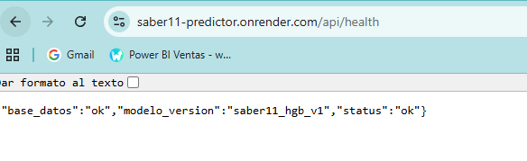

**Predicción** con puntaje, rango probable y barra de error (RMSE).

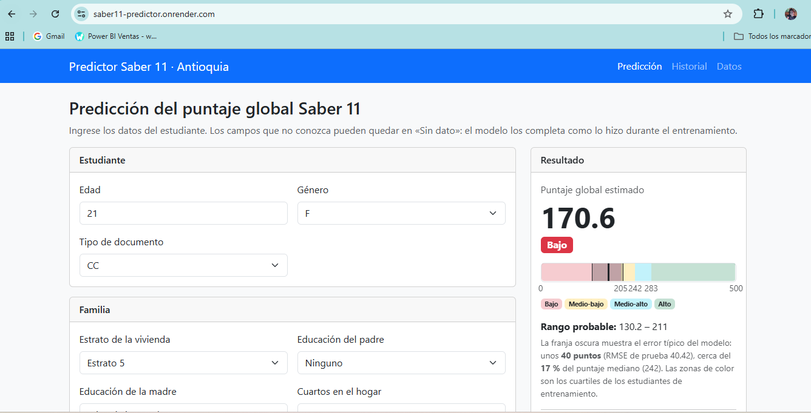

**Historial:** predicciones hechas desde Render y desde el entorno local en modo Neon, guardadas en la misma base de datos.

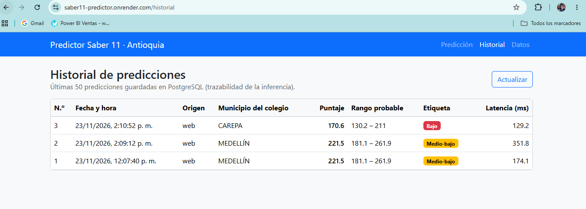

**Datos:** ingesta desde datos.gov.co y explorador de los datos normalizados.

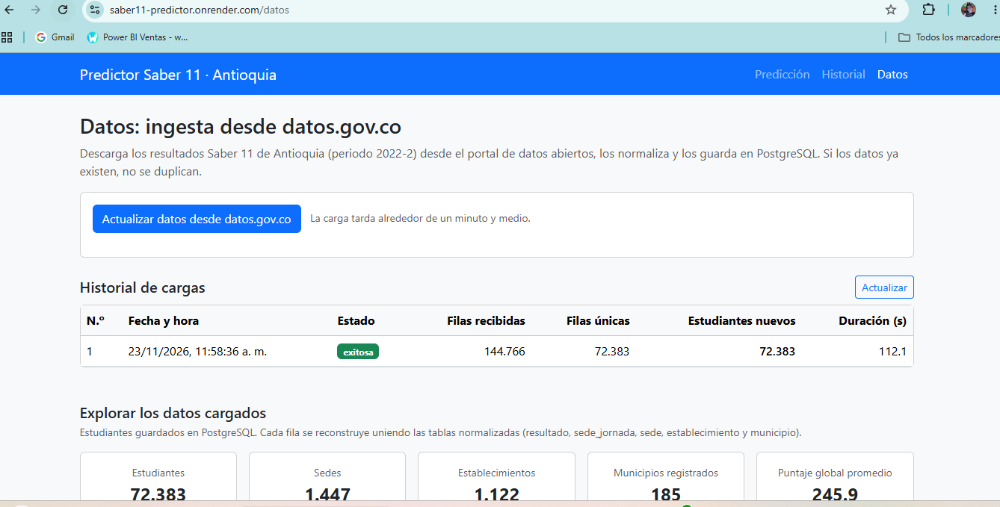

**Despliegue automático** en Render tras un commit.

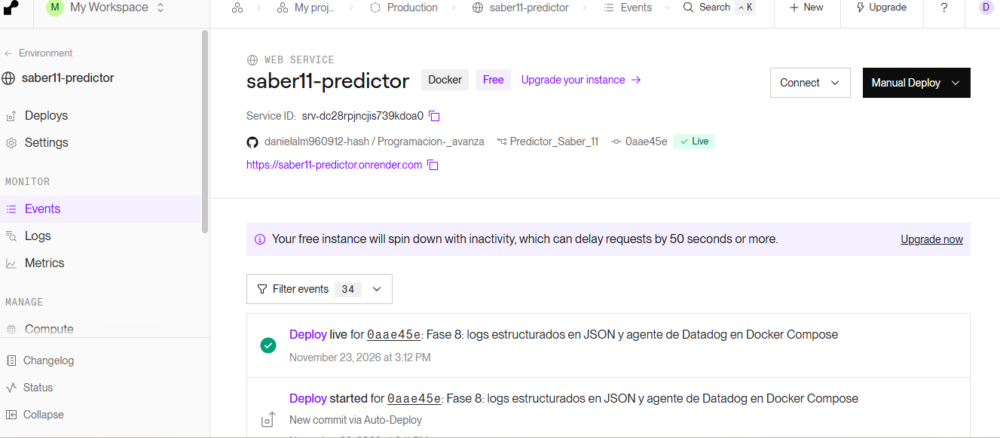

### Observabilidad (Datadog)

**Log Explorer** filtrado por el servicio.

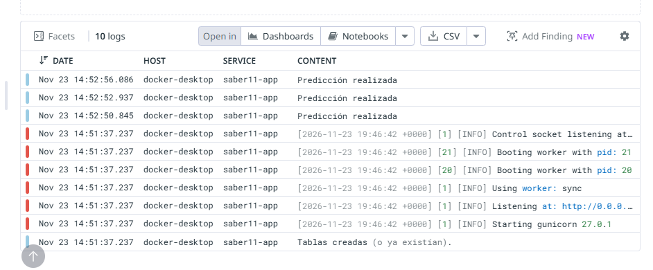

**Log estructurado** de una predicción con sus campos.

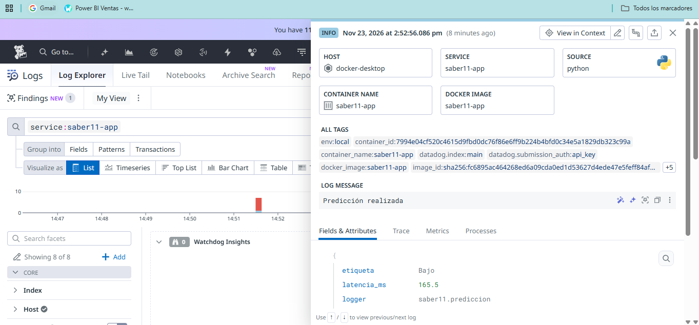

**Logs JSON** generados por la aplicación.

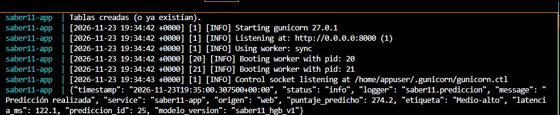
